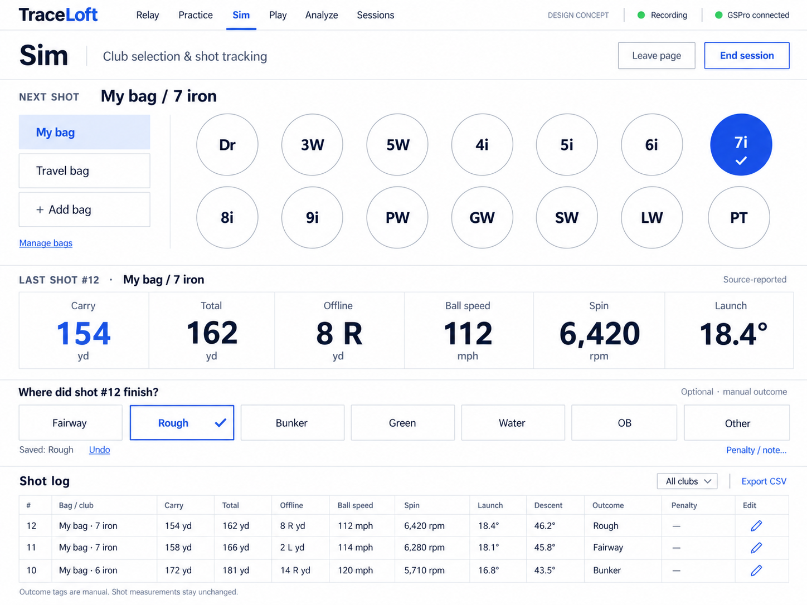

# Sim page concept — 2026-10-03

Requested mockup, pending user review; no Sim route or outcome-tagging behavior is implemented by
this design work. Generated with the built-in image-generation tool using synthetic readings.
Full prompt: [sim-page-vector-v1-prompt.json](sim-page-vector-v1-prompt.json).

## Proposed interaction

- Keep the Vector white/navy/cobalt language and healthy recording state in the global header.
  Proposed navigation adds Sim between Practice and Play; actual navigation remains unchanged.
- Next shot: compact bag rail with direct circular club selection to its right. Use large,
  well-spaced touch targets (roughly 68–80 CSS px), with a check plus color for selection. Render
  each bag's real club list; the illustrated 14 clubs are not a limit. Preserve More bags access
  when all three quick slots are occupied, and the established full-width Manage bags control.
- Last shot: freeze bag/club identity independently of next-shot selection. Show large carry,
  total, signed offline, ball speed, total spin and launch tiles; retain descent and other available
  fields in the detailed log. Missing values stay unavailable, estimates identify their provenance.
- Optional result entry asks where the last identified shot finished: Fairway, Rough, Bunker,
  Green, Water, OB or Other. Save with one tap, show the saved result and Undo. An unanswered result
  is unknown, never implicitly fairway. This is manual tagging inspired by on-course tracking,
  not a connection to 18Birdies or a claim that a simulator returns these fields.
- Attach edits to a stable shot ID, not whichever shot is newest when a request completes. If a
  new shot arrives while a result/note editor is open, retain its original target and identify it.
- Penalty / note opens secondary entry for explicit penalty count and optional context. A lie tag
  alone must not add strokes. Hole, starting lie, target intent and remaining distance can be
  optional detail fields if needed for later round analysis; do not imply full scoring without them.
- Detailed newest-first log shows original readings, bag/club, outcome and penalty annotations;
  allow correction with history/Undo. Manual outcomes must remain distinct from measured metrics
  and game-generated results. Outcome corrections never silently exclude shots from analysis.
- Leave page preserves the active session; End session ends recording to it explicitly. Retain
  existing abandonment/review paths and red ended-state feedback when implementing.

## What Play already stores

Code review of `GolfSimSession.add`, inherited `PuttingSession.save`, and `Store.save_session`
confirms each accepted game attempt retains `game_outcome` in SQLite session and attempt payloads:
starting game state/lie, frozen aim context, source metrics/equipment, adjusted endpoint and
destination lie, remaining distance, lie reduction, random variation, per-shot penalty/concession
counts, and resulting game state/score. Course and rules are saved with the session/outcome.

Destination categories include tee, fairway, rough, sand, green, water, nature and out of bounds.
Water/OB retain the hazardous endpoint even though the playable position stays at the prior lie
under the current replay-plus-one rule. Invalid/stale attempts remain saved with an unapplied outcome
and explanation. Excluding a shot from analysis does not undo its played strokes or penalties.

These are internally simulated endpoint outcomes, not external simulator telemetry. Terrain crossed
in flight and detailed bounce/collision histories are not calculated. General manual outcome tagging
for Sim and richer outcome analytics remain planned. This audit checked code/storage paths, not a
new live round or production database mutation.

## Review and implementation checks

Visually checked the generated image: separate Next/Last shot identities, 14 club choices, large
metric tiles, optional outcome row, detailed log and exits are present. Bitmap dimensions are
1448x1086 (4:3); this is a composition reference, not tested CSS or physical iPad acceptance.
During implementation prioritize 13/12.9-inch iPad Pro landscape, retain phone/desktop support,
verify target sizes and readable metrics, and make table overflow deliberate. Log editing controls
will need larger touch hit areas than the dense illustration suggests. Test manual corrections,
new-shot races, untagged/unknown outcomes, ended/review states and navigation guards on isolated data.
