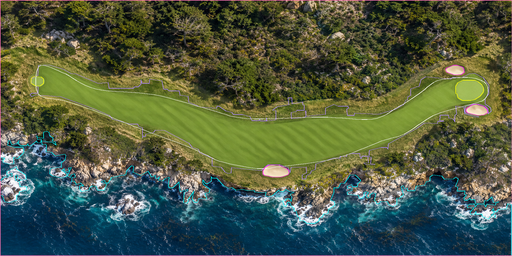
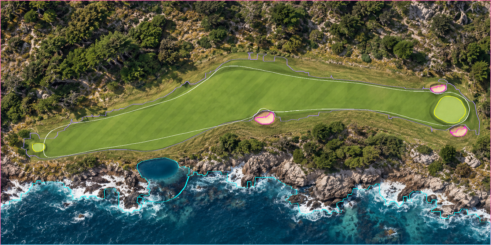
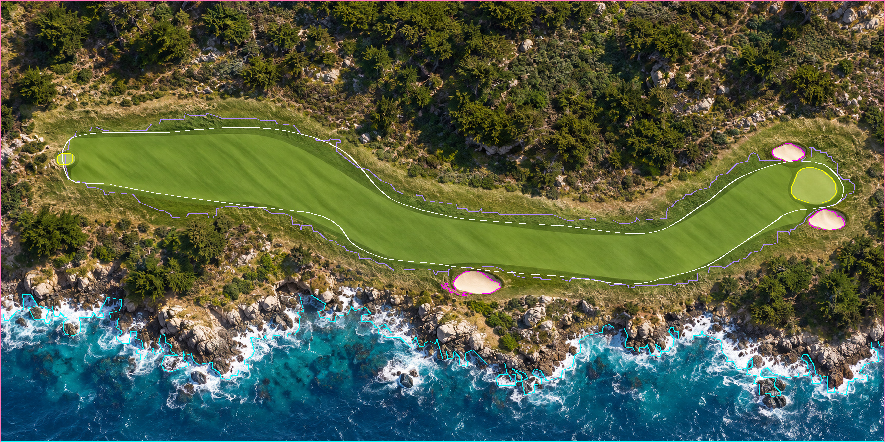
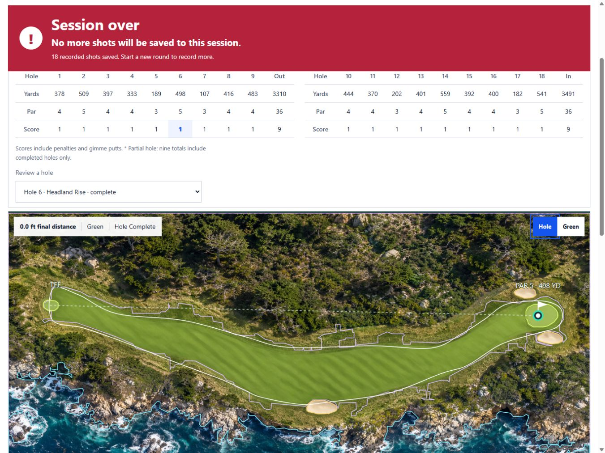

# Boulder Beach fairway refinement — v3

User review identified three issues missed by the first automated registration review:

- Hole 6: the largest color-mask component stopped before the green, leaving a false rough gap
  through the visible approach. The reviewed fairway now encloses the putting apron/green footprint.
- Hole 16: lighting and mowing stripes created narrow notches along the perimeter. Trace the visible
  edge smoothly, including the upper shelf and approach, while retaining the original bunkers.
- Hole 18: dark stripes created inward cuts in otherwise continuous fairway. Replace those cuts
  with a smooth perimeter, preserving the curve and taper into the green.

Only the fairway polygons on those three holes changed. Boulder v3 preserves all other geometry,
greens, tees, hazards, pin locations, artwork, transforms, playing lines and 6,801-yard scorecard.
New hole IDs identify the new version; v1/v2 packages and frozen rounds remain intact. New rounds
use `pebble-boulder-blue-v3`; Sheboygan Straits remains v2. Refresh/start a new round for these edges.

[`refine_boulder_fairways.py`](../../courses/refine_boulder_fairways.py) records explicit control
points traced on native 1774×887 artwork, samples smooth closed curves and converts them through
the existing uniform yard transform. It validates polygons and refuses to overwrite a different
released v3. Reproduce v3 with `python courses/refine_boulder_fairways.py`; export the current
catalog using `python courses/render_registration_review.py --individual --output <folder>`.
This manual refinement complements color extraction where stripes/shadows make classification uncertain.

Tests verify expected fairway locations in the old gap/notches, retain outside rough/nature points,
keep the green footprint enclosed, compare every unchanged surface/registration field to v2, and
check the historical v2 hashes. Current manifest includes ten additional fixed fairway landmarks
(598 total across 36 holes). Full-round checks include both current courses, putting and frozen review.

Isolated service/SQLite on 8879: completed a synthetic 18-hole v3 round, reviewed holes 6/16/18
with artwork/scoring overlays at iPad 1366×1024, and retained the full-map hole 6 screenshot below.
No live production test shots. Physical Safari/touch remains unverified. Exported gallery/ZIP is
in Downloads/TraceLoft-course-boundary-review-v3; earlier Downloads pack remains the v2 review.

White: fairway; yellow: green/tee; magenta: sand; cyan: water; purple: nature; pink: map OB limit.

