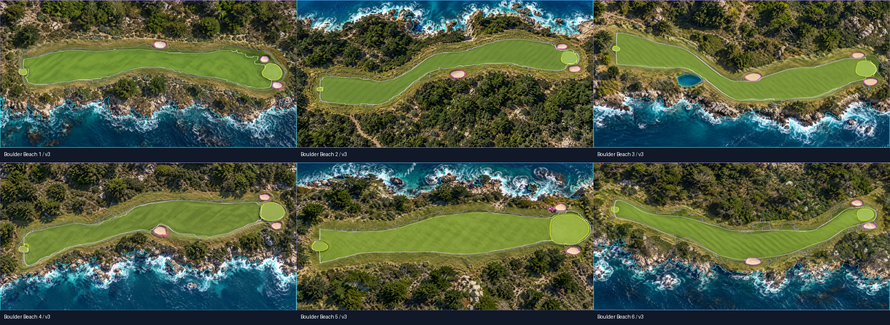
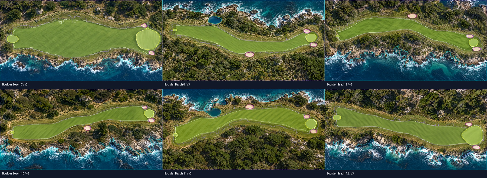
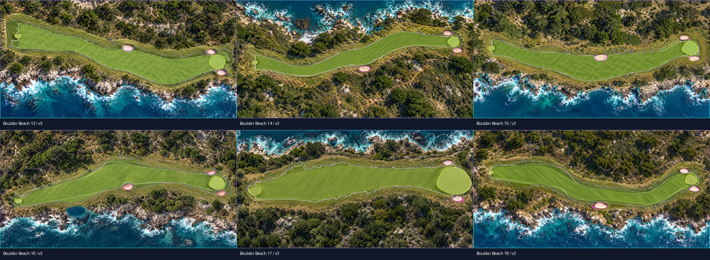
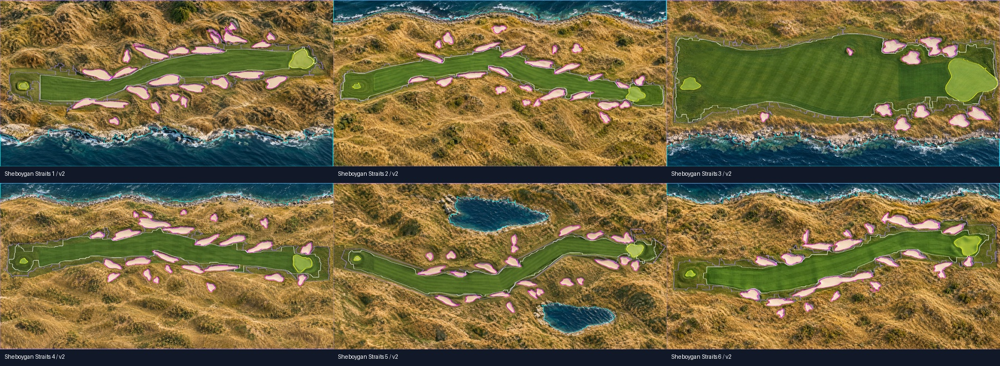
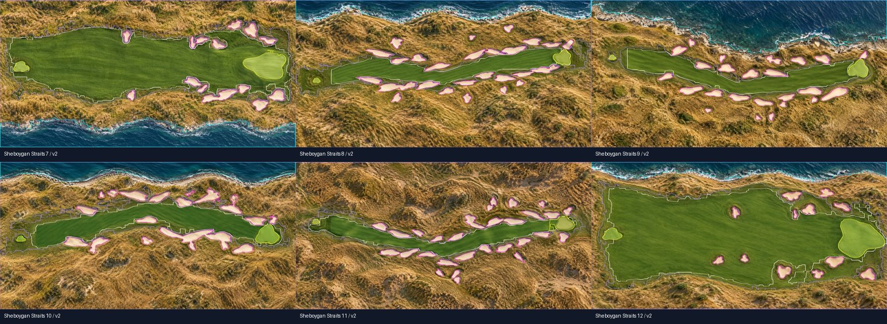
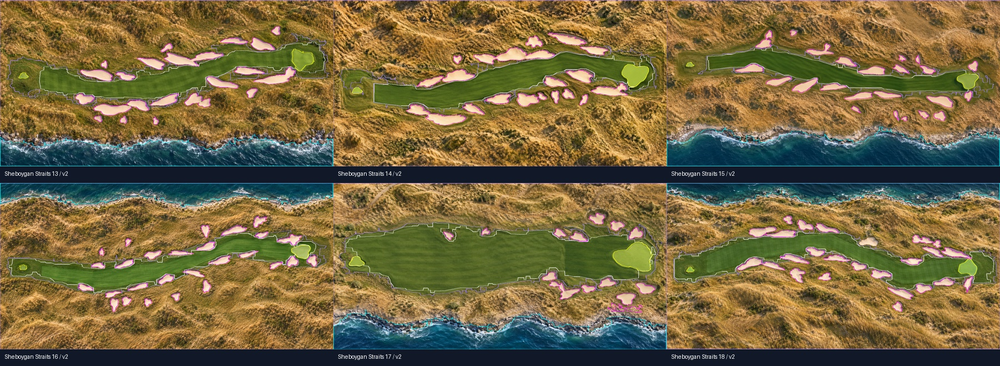
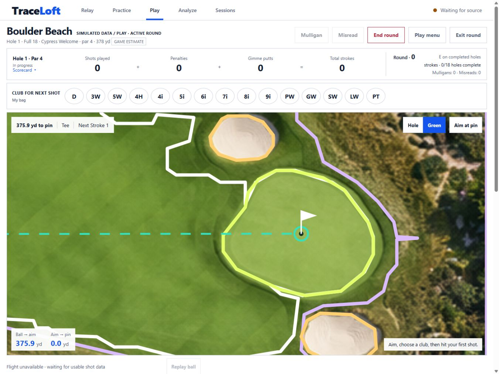
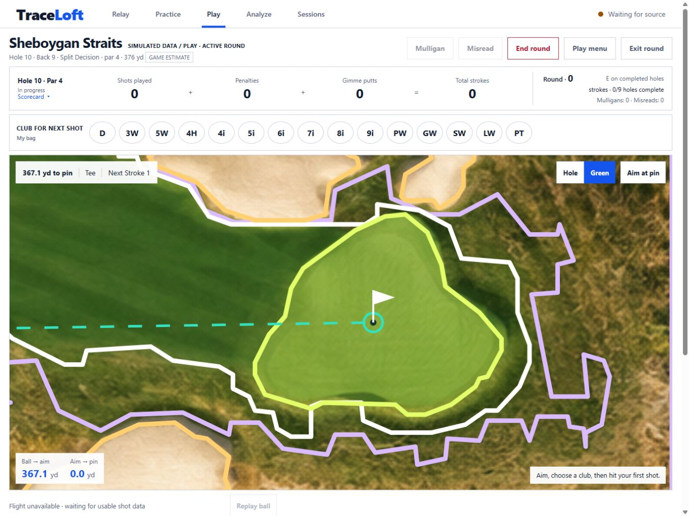

# Finished artwork and scoring boundary review — 2026-10-03

Reviewed all 36 holes in Boulder Beach and Sheboygan Straits, with outlines in the same registered
image frame used by Play. The original Boulder Beach guide polygons did not follow several final
bunkers, greens, tees, ponds or shorelines. This was a geometry/art disagreement, not a camera
stretching problem. Sheboygan Straits' earlier tracing was substantially closer; its fairway edges
and hole 10's incomplete putting surface needed refinement.

New rounds select `pebble-boulder-blue-v3` or `sheboygan-straits-blue-v2`. The names, Blue pars and
yardages remain unchanged. Original PNGs and v1 JSON packages remain untouched. Existing rounds
freeze their own geometry, including unfinished rounds; refresh does not replace that snapshot.
Start a new round to use these reviewed boundaries.

User review found a missed approach/green connection on Boulder 6 and mowing-stripe notches on
16 and 18. The [v3 follow-up](../boulder-fairway-refinement/README.md) replaces those fairway
perimeters with smooth reviewed control points. The v2 package/images and `review-v2.json` remain
historical evidence. The current `review.json` follows the catalog, including the v3 corrections.

- Boulder Beach: retraced all 18 holes from finished pixels, moved tee/pin to visible surfaces and
  recalculated a uniform yard scale along the same published route distances. Retained 50 bunkers,
  registered the ocean and four small ponds, and rejected tree shadows misidentified as water.
- Sheboygan Straits: refined fairway contours on all 18 holes and recovered the full hole 10 green.
  Preserved its 354 sand regions, water, tee/pin placements and yard registration.
- Stored asset and geometry hashes plus 588 original reviewed pixel probes, including regression
  landmarks for Boulder Beach 1, Sheboygan Straits 10 and rejected tree-shadow water candidates.
  The v3 follow-up adds ten fairway landmarks, bringing the current total to 598.

The silhouettes are simplified vector traces. Fine grass textures, soft mowing transitions, surf
foam, bunker lips and shadows do not define additional lies or collisions. Nature covers the
surrounding vegetation; individual trees are scenery. The rectangular game boundary is an artificial
map limit, not an inferred official OB line. This review does not validate physical simulator accuracy.

## Visual evidence

Review sheets use magenta sand, cyan water, yellow green/tee, white fairway and purple nature.
Play's optional overlay uses gold for sand. The game, overlay and simple-fill fallback all read the
same frozen polygons; changing the camera does not change classification.

## Reproduction and verification

Design-only dependencies are OpenCV, NumPy and Pillow in a separate environment. Run
`python courses/register_finished_art.py`, then `python courses/render_registration_review.py`.
To reproduce Boulder v3, run `python courses/refine_boulder_fairways.py` after the original v2
registration and before rendering. Its native-art control points are explicit and versioned.
Registration reads the original art/v1 packages and reproduces v2; it refuses to overwrite a
different existing v2. Thresholds and reviewed seed regions are specific to these assets. New
artwork requires fresh extraction and visual review, not reuse of this approval.

For individual-hole review, run the renderer with `--individual --output <review-folder>`.
It exports all 36 holes at the original 1774×887 artwork resolution, plus six overview sheets,
an offline `index.html` gallery and `course-boundary-review.zip`. Gallery links jump to a course
or hole; clicking an image opens its full size. Pink marks the artificial map OB perimeter in
individual exports. The original overview sheets/manifest remain identical. Generated review packs
can live outside the repository; they do not change artwork, geometry, live state or the database.

The registration script accelerates tracing by using color masks, contour cleanup and known guide
regions, then converts image coordinates to uniform yard coordinates and validates tees/pins/shapes.
The render script accelerates review by drawing every saved polygon over its artwork in one run,
producing fixed pixel probes and hashes for regression checks. These helpers currently target the
two bundled courses; extracting an arbitrary new course still needs adjusted masks/seed regions
and human visual approval. Automatic probe generation is a proposal, not independent proof of alignment.

[review.json](review.json) records reference pixels, fixed labels and asset/geometry/legacy hashes.
The render script proposes fixtures; reviewing the actual artwork is required before accepting them.
Hash and point tests guard later drift but do not replace visual review.

Isolated browser review: new Boulder Beach setup, green/overview boundary overlay, bunker landing
(carry 366.2 / total 386.2 yd → sand / zero rollout), ended review, then Sheboygan Straits Back 9
starting on hole 10. Checked iPad 1366×1024 and 1376×1032, reduced-height 1366×900, desktop
1440×900 and phone 390×844 with no horizontal page overflow or browser errors. Physical Safari
and live-monitor distance conventions remain unverified. See [work log](../../WORK_LOG.md).
