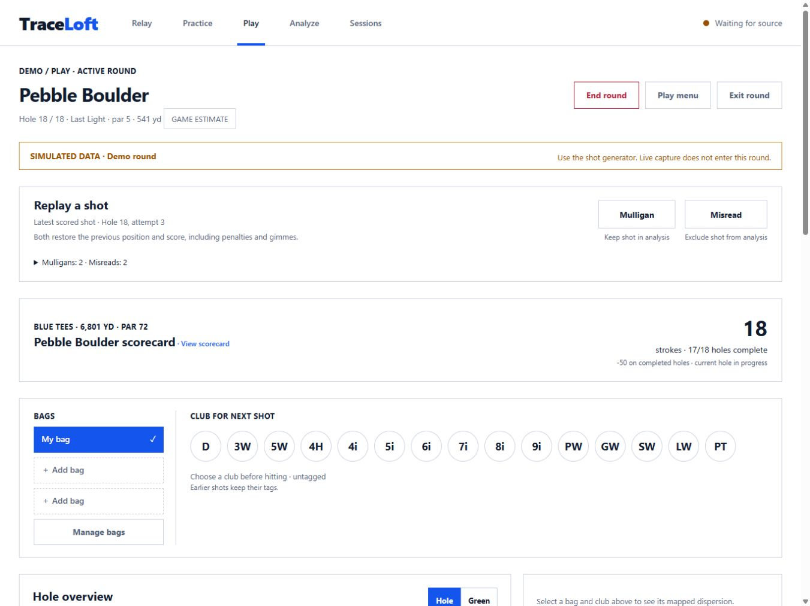

# Play shot corrections

Implemented 2026-10-03 using the approved white Vector interface. The replay strip keeps both
actions above the scorecard and map; it stays available when a hole or round finishes. The target
identifies the latest eligible attempt, and history separates mulligans from misreads.

This isolated demo shows hole 18 after reopening from saved review, followed by another attempted
shot. The prior readings remain in the log. Verified at 1366×1024 / 1376×1032, 1440×900 and 390×844.
See [operating controls](../../docs/PEBBLE_BOULDER.md#correcting-a-shot).
