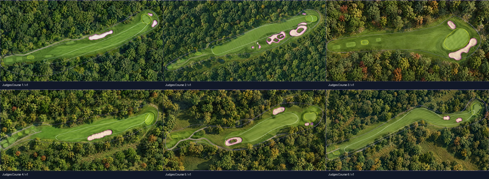
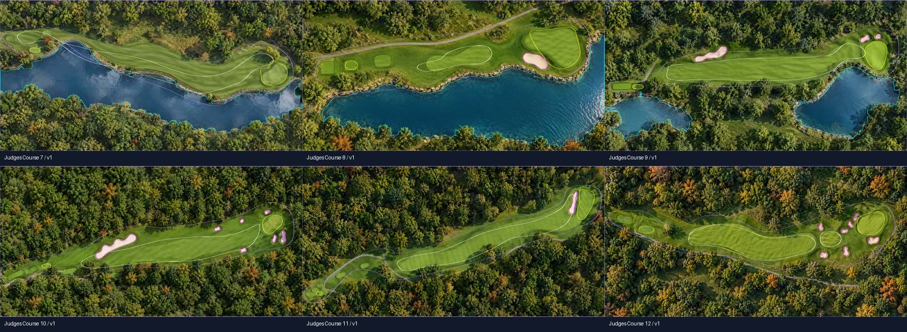
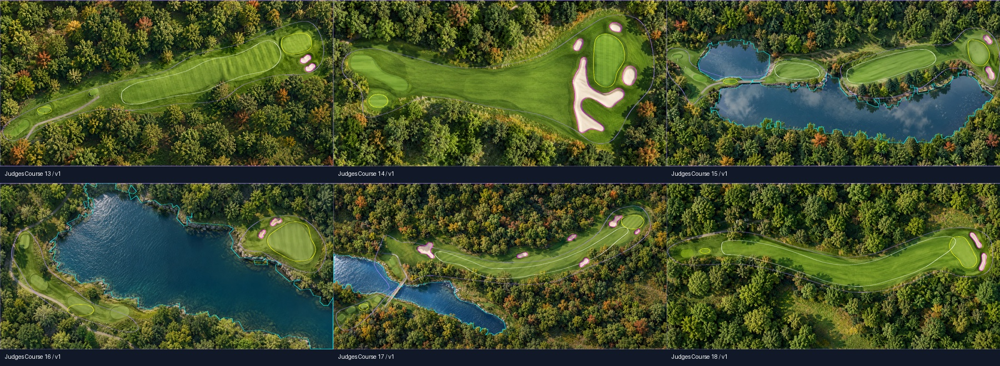
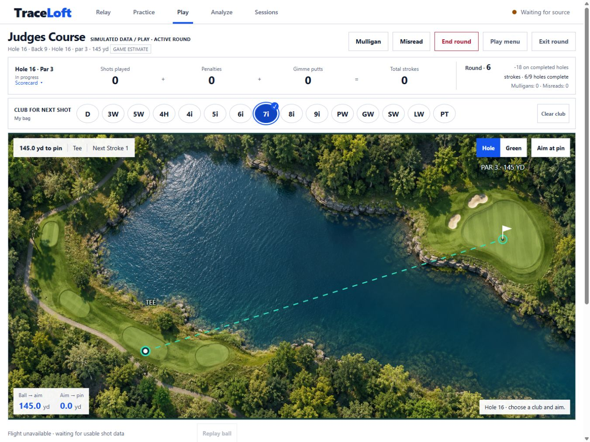

# Judges Course design and review

Use supplied hole maps for routing and four supplied photographs for wooded parkland, natural
water, layered stone banks, pale sand and gentle autumn accents. Built-in imagegen produced
18 separate aerials: [full prompt set](prompts.json), [source inventory/hashes](sources.json).
Original reference files remain unmodified. [Operating guide](../../docs/JUDGES_COURSE.md).

Reviewed finished-art turf controls ignore mowing changes; sand contours retain grass cutouts.
Explicit bunker seeds reject pale cart paths/shoreline rocks. Lake reflections remain water.
Native image proportions and uniform yard scale are preserved; scenery and soft turf edges
are simplified, not surveyed. Middle tee pads are provisional.

White fairway; yellow putting surface/selected tee; magenta sand; cyan lake; purple nature edge.
The game, boundary overlay and simple-fill fallback read the same polygons.

Checks: all 18 aerials/overlays reviewed, opening false fairway extension corrected, grass
islands on 2/5 and separate fairways on 12/15 retained. Independent water-carry, supplied
scorecard, selected nines and native aspect checks pass. Shared manifest adds artwork/geometry
hashes and fixed pixel probes. API exercises complete round/putting, bunker stopping, Misread
restoration and immutable saved review. Browser setup/club selection/map/green/boundary toggle
checked on iPad 1366×1024/1376×1032, 1366×900, desktop1440×900 and phone390×844: no page overflow
or browser warnings/errors. Physical Safari/live-monitor acceptance remains unverified.
See the [work log](../../WORK_LOG.md) for final test counts and operational handling.
