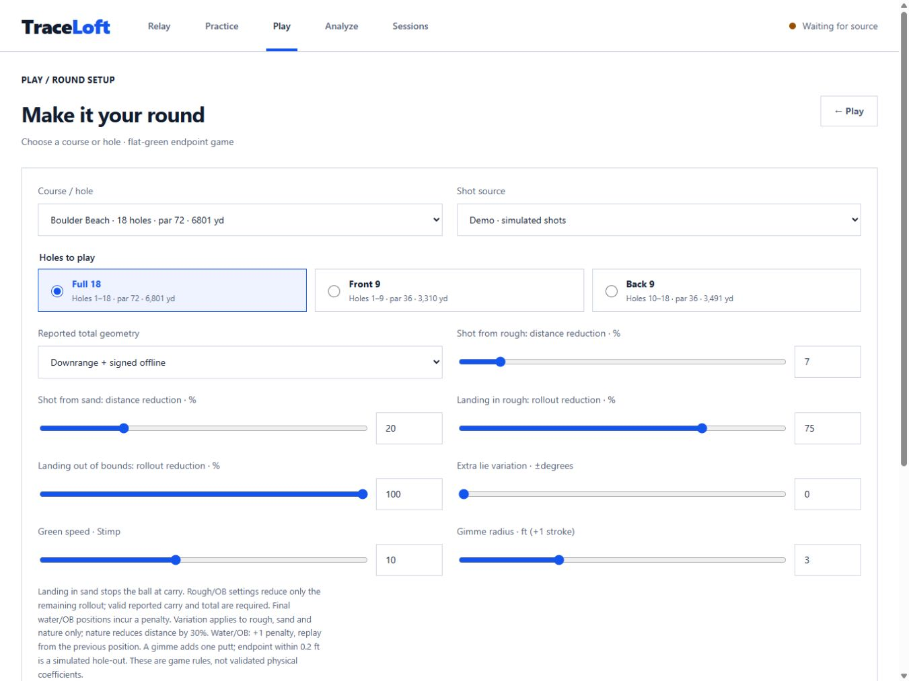

# Landing rule UI review

Round setup separates Shot from rough/sand distance effects from Landing in rough/OB rollout
effects. Default rollout reductions are 75%/100%. Sand always stops at the estimated carry point.
The synthetic shot form now accepts optional carry; the log shows raw carry/total/offline, game
travel, landing surface and adjusted rollout. No additional card crowds the live map.

Isolated browser checks covered launching defaults, a bunker landing with carry 364.8 yd and
source total 420 yd, zero rollout, saved log evidence, replay/Skip, reload and Misread restoration.
Verified iPad landscape, desktop and phone sizing with no page overflow and 48px numeric controls.
Scoring follows the saved boundaries. Checking the boundary overlay on Boulder Beach hole 1
revealed a visible art/geometry offset, now tracked as a separate P1 backlog item.

