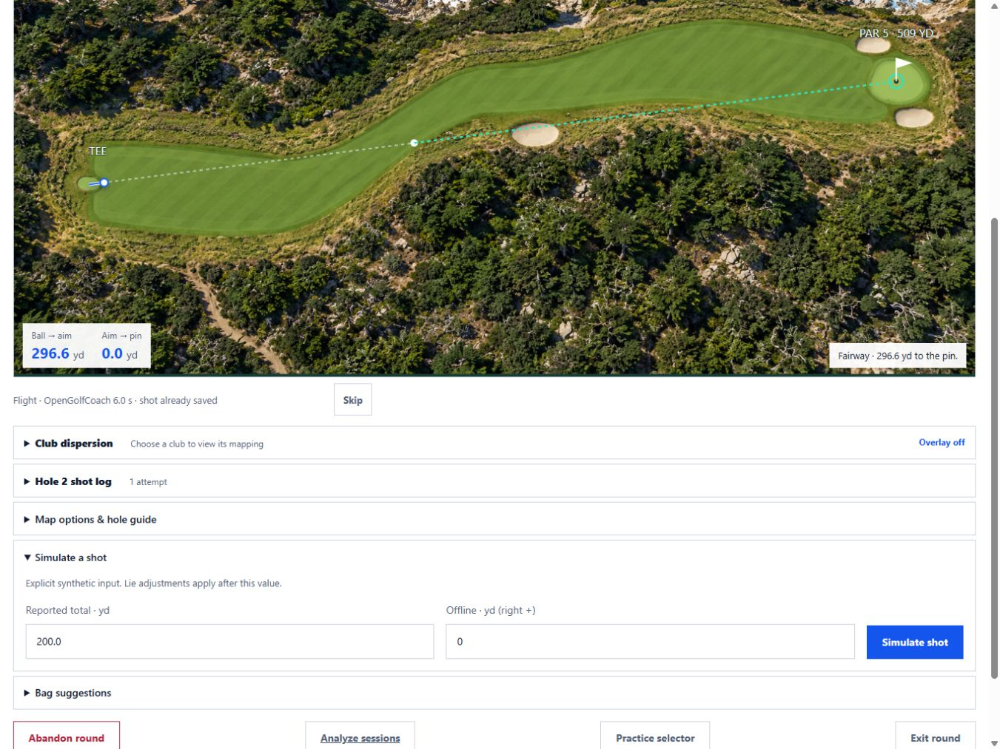
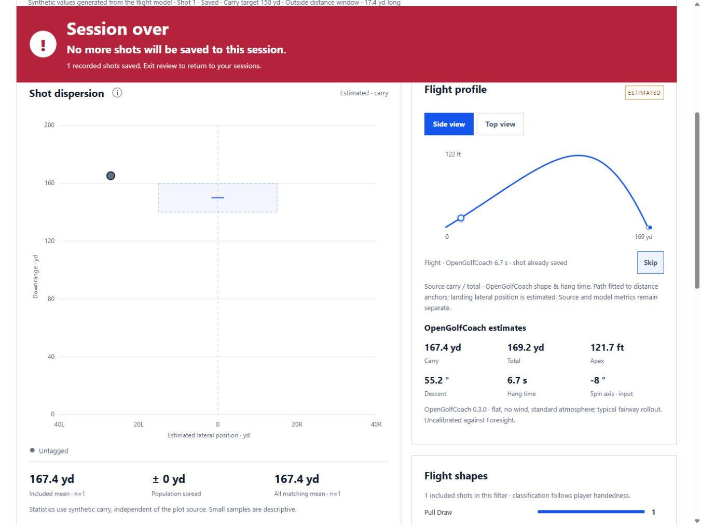

# Ball replay review — 2026-10-03

Implemented source-anchored replay on Range's side/top flight profile and Play's registered map.
OpenGolfCoach supplies estimated trajectory and hang time; roll timing and fitted lateral landing
position remain illustrative. Play retains endpoint scoring and lie rules. A white ball with cobalt
outline and a white-backed blue tracer remains visible over course art. Replay/Skip are 44px controls.

Verified using synthetic shots on isolated service/database at port 8879:

- Range arrival animates while the shot is already saved; Skip, Replay and top view work.
- Reload and saved review establish a baseline without automatic history playback.
- Play arrival saves score immediately; Skip restores the final ball marker.
- Completed-hole replay retains the overview until finish/Skip, then returns to green view.
- Misread reopens the hole, clears playback and restores score; gimme count remains separate.
- Next hole clears prior playback; no animation writes change shot counts.
- iPad 1366×1024 / 1376×1032, reduced-height 1366×900, desktop 1440×900 and phone
  390×844: no horizontal page overflow and Replay/Skip at least 44px high. Inspected Range
  phone and iPad charts and Play phone/iPad map visually. Physical iPad Safari remains untested.
- Unit checks cover modeled timing, source anchors, missing data, hazard endpoint preservation,
  putts, invalid/corrected shots, deduplication, navigation baselines and reduced-motion gating.

