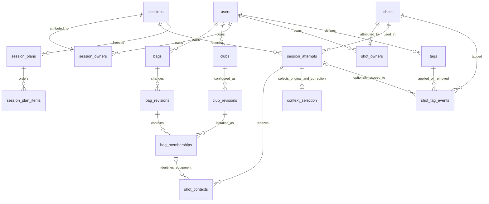
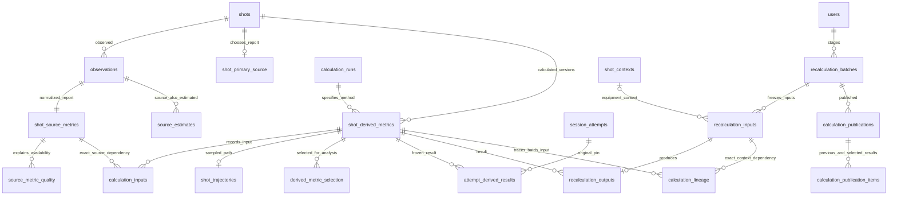
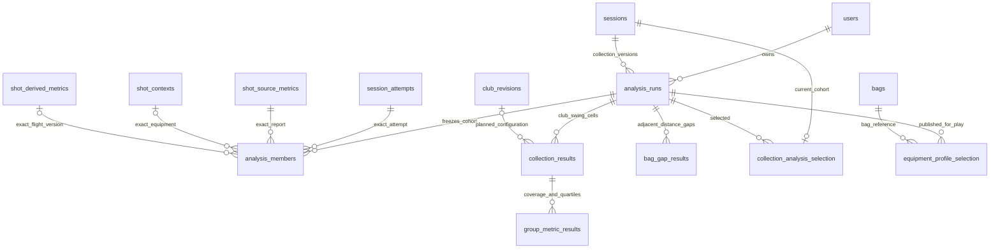

# TraceLoft database relationships — schema 6

These diagrams show the principal implemented relationships. Auxiliary mapping/quality/import,
typed-state and audit tables are described in [the database guide](SHOT_DATABASE.md).
Names match SQLite. Ownership is explicit through `session_owners` and `shot_owners`; unknown
inbound ownership is allowed. Local profiles are independent of authentication.

`shot_source_metrics` holds all 18 core reported columns, including total. `shot_derived_metrics`
holds calculated columns. Join each to `shots.id` through `shot_id`; multiple reports/versions are
intentional. Use the selected-source/current-attempt views for ordinary analysis, rather than a
raw many-report/many-version join that would multiply shots.

JSON is immutable evidence or a whole model/geometry/trajectory artifact. Bags, configurations,
tag associations, collection membership and numeric measurements are relational. Variable drill
state uses typed paths in `session_fields`/`attempt_fields`; compatible browser DTOs are assembled
from those rows. Scores and original model pins are never replaced by analytical publication.
