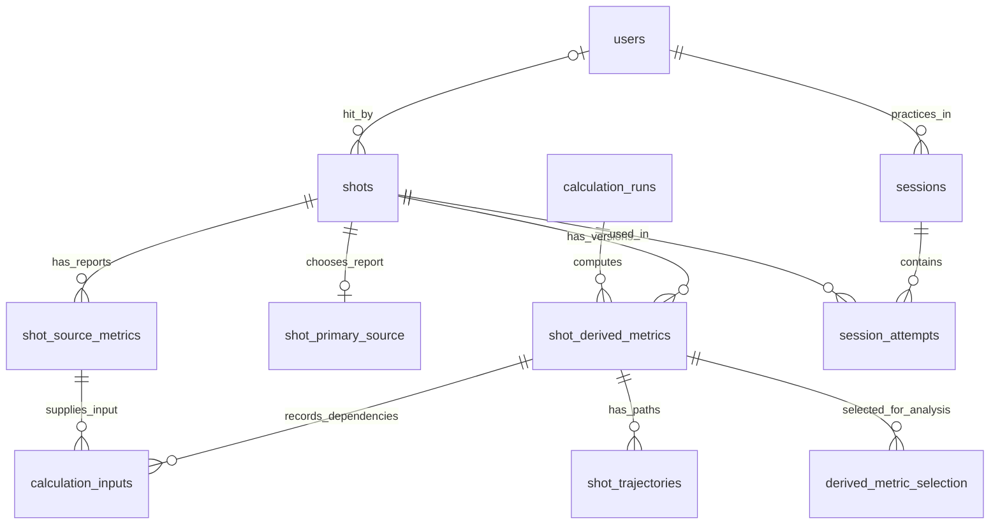
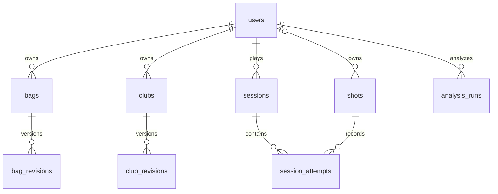
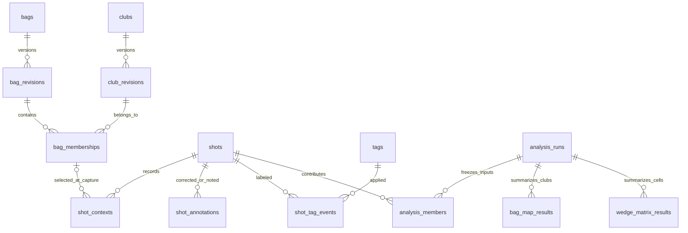

<!-- Current implementation: schema 5 supersedes historical proposal/stage notes below. -->
# Readable shot data and versioned calculations
**Current implementation — schema 5 (2026-10-10):** source/derived wide metrics, relational golfers,
equipment/configurations/context/tags/session state, SQL-backed Analyze, immutable bag/wedge cohorts
and staged recalculation/publication are implemented. Historical outcomes remain pinned. Start with
[current database guide](SHOT_DATABASE.md) and its ERD; Google Drive backup remains proposed.


Design and migration plan — 2026-10-10. Stage 1 (schema 2) implements wide source reports,
separate immutable derived results, attempt pins, readable views and expanded CSV export.
Schema 3 implements golfers/equipment/context/tags/plans and typed session state. See
[implemented database](SHOT_DATABASE.md). Schema 4 adds SQL-backed Analyze, immutable collection cohorts, per-metric coverage and explicit profile publication. Schema 5 implements staged batch recalculation, exact input lineage, version history and reviewed publication.
This updates the earlier preference for long-form metric values as the main analytical interface.
The user now prioritizes named columns and a separate, recalculable derived-metrics table.

## Why change

Read-only inspection of the pre-migration schema-v1 database found 1,305 physical shots, 2,429
observations, 32,406 metric-value rows, 47 sessions and 1,089 attempts. Counts are a point-in-time
inventory, not migration acceptance targets. 1,089 shots have multiple observations; these often
include ingestion and practice evidence. No shots currently appear in multiple sessions, but the
schema permits it. A migration cannot assume one observation equals one physical shot.

Before stage 1, `shots` stored identity/time/source club code. Numbers required joins through `observations`,
`metric_values` and definitions. OpenGolfCoach and putting results are frozen in session/attempt
JSON, rather than a queryable derived-metrics table. Stage 1 addresses those numerical storage/SQL
limitations while preserving the original evidence and outcomes.

## Recommended layout

| Table | One row represents | Purpose |
| --- | --- | --- |
| `users` | One local golfer profile | Stable user ID, display name, handedness, creation/archive dates; independent of authentication |
| `shots` | One physical shot, retaining its existing ID | Identity, time, source-event link, synthetic flag; readable identity/date fields |
| `shot_source_metrics` | One normalized source report/revision about a shot | One nullable numeric column per supported metric; immutable source values |
| `shot_primary_source` | The explicitly chosen source report for a shot | Gives everyday queries one source row without discarding other reports |
| `calculation_runs` | One batch using one model/configuration/output schema | Records methodology, settings, code/package identity, lifecycle and publication status |
| `shot_derived_metrics` | One shot result under that run and input/context revision | Separate named columns for TraceLoft outputs; append new results when methods change |
| `calculation_inputs` | One exact source/result/context dependency of a result | Reproducible lineage, including dependencies on earlier calculations |
| `shot_trajectories` | A flight/roll sample sequence belonging to a derived result | Keeps large paths out of the scalar table |
| `derived_metric_selection` | The selected result for a shot, model family and context | Explicit current analytical version; switching it does not rewrite historical results |

Retain raw events, original imports, source/configuration identities, mappings, sessions/attempts,
inclusion decisions and audits. These are evidence/context, not metrics a person must join for
ordinary analysis. Keep the model families separate: full flight, putting, source comparison and
target/game-context analysis. Aggregates/outlier baselines belong to versioned analysis cohorts,
not to the physical-shot metric row.



All source/derived result sets carry `shot_id` as a foreign key to the existing `shots.id`.
Source rows additionally identify their observation and normalization revision. Derived rows
identify `run_id`, their own stable result ID and an input/context fingerprint. Multiple result
versions for one shot are intentional. Composite foreign keys must prevent selecting a report or
derived result belonging to another shot or model family.

## Users and ownership

Users are first-class golfer profiles, not device records or bags. Add `users(user_id, display_name,
handedness, created_at, archived_at)` and foreign-key ownership on `bags`, `clubs`, `sessions`,
`shots`, reusable user tags and `analysis_runs`. Bag/club revisions inherit the stable entity's owner;
source/derived measurements inherit their shot's owner. Sources can serve several golfers and should
not become golfer identities. Shared equipment/coaching access can be modeled explicitly later.

A session freezes its selected golfer at start; upcoming-shot bag/club choices must belong to that
golfer. A player change starts a separate session or an explicit future multiplayer turn, not a
silent change to earlier shots. Show user name in readable shot/map/matrix views and filter equipment,
statistics, calibration and selected profiles by user. A bag map or wedge matrix must not pool two
players just because their clubs share a label. Composite foreign keys and service validation must
reject mismatched session/shot/equipment ownership; tests cover cross-user references and selections.

Local profiles do not require logins. A user selector identifies the golfer; it is not an access-control
boundary. If the app later offers authenticated remote multi-user access, map accounts/permissions
separately to golfer profiles and enforce authorization at the service, rather than trusting a supplied
user ID. Current localhost ownership/access behavior remains unchanged by this design.

Migration creates a local profile for the existing single-player setup, retaining all shot/equipment
IDs and recording assignment evidence. Ambiguous imported history or unassigned inbound shots may
have null owner until reviewed; do not infer a player from device ID or attach every incoming packet
to the most recently viewed profile. An active session or explicit input-golfer selection provides
shot-time ownership. Preserve original attribution and audit subsequent corrections. Future shared
equipment transfers require explicit ownership history, not renaming another player's club.



## Relational data versus JSON

Core queryable entities and relationships should be rows/columns: users, bags, clubs/membership,
shot ownership/context/labels, session plans/attempts, exclusions/corrections and scalar results.
Use keys, foreign keys, uniqueness, typed columns and indexes. Do not replace these with a catalog
or session JSON document that requires application code to enforce relationships or decode analytics.

JSON remains appropriate for immutable original protocol packets/import evidence, model-specific
parameter snapshots, archived legacy payloads and geometry/trajectory documents consumed as complete
versioned artifacts. Any fields routinely filtered/joined/validated need explicit relational columns
or sample tables. Never hide `user_id`, `bag_id`, `club_id`, analytical inclusion or metric values only
inside those documents. Extract queryable model identity/context keys alongside parameter snapshots.

During migration, preserve legacy JSON as evidence/read compatibility. The new relational representation
becomes authoritative for editable core state; retained snapshots are immutable evidence or reproducible
exports, not a second independently editable copy. Transactional reconciliation must check the transitional
representations. Moving core tables does not require deleting raw source JSON or rewriting frozen courses.

## Equipment, shot context, tags and collection results

The metric tables are only one part of the database. Equipment/context describes what was hit;
bag maps and wedge matrices summarize groups of shots. Neither belongs inside a sensor-metric row.

### Original schema-v1 locations (equipment/session authority remains during stage 1)

| Feature | Implemented schema-v1 location |
| --- | --- |
| Bags and club lists | Versioned `equipment_catalog.v1` JSON in `metadata`; current club IDs are scoped to each bag |
| Club/bag selected for upcoming shots | Session `equipment_selection` in `sessions.payload_json` and active service state |
| Club/bag recorded on a shot | Frozen `bag_id`, `bag_name`, `club_id`, `club_label`, `catalog_revision`, `selection_mode` in attempt payload JSON |
| Club corrections and exclusions | Attempt `corrected_equipment`/excluded/removed overlays, session cleanup history, inclusion rows and audits |
| Source's club code | `shots.reported_club`; independent of manual selection/corrections |
| Bag mapping plan | Session `collection_plan`, `collection_samples`, `range_metric` JSON |
| Wedge matrix plan and shot swing labels | Session wedge plan/`swing_labels` plus each attempt's frozen `swing_label` |
| Bag-map and matrix summaries | Calculated from included session shots by browser collection code; not dedicated persisted result tables |
| General custom shot tags | Proposed capability; no general relational tag system currently implemented |

Existing summaries use medians/type-7 quartiles and exclusion/removal rules documented in
[bag mapping](BAG_MAPPING.md) and [wedge matrix](WEDGE_MATRIX.md).

### Proposed explicit tables

| Table(s) | Row meaning / main relationships |
| --- | --- |
| `bags`, `bag_revisions` | Stable bag identity and named/configuration revision |
| `clubs`, `club_revisions` | Stable physical club identity and optional make/model/loft/shaft/settings revision |
| `bag_memberships` | A club revision in a bag revision, with its position/display label; a physical club may belong to multiple bags |
| `shot_contexts` | Immutable shot-time bag/membership/club revision, swing intent, ball/lie/target/environment and selection method, linked by `shot_id` |
| `shot_annotations` | Append-only corrected context/notes with shot or attempt scope, reason/time and superseded revision; preserves original context |
| `tags`, `shot_tag_events` | Reusable named tags and audited add/remove associations to shots or explicitly scoped attempts |
| `session_plans`, `session_plan_items` | Drill configuration and planned clubs or wedge × swing cells, sample goals and distance basis |
| `analysis_runs`, `analysis_members` | A reproducible group analysis and exact included shot/input/context/inclusion revisions |
| `bag_map_results` | One club summary in an analysis run: bag/club revisions, distance basis, count, median, Q1/Q3/IQR and metric coverage |
| `bag_gap_results` | One explicit neighboring-club pair in that run: median gap and interval overlap; avoids an unexplained single gap field |
| `wedge_matrix_results` | One wedge × swing-intent cell in an analysis run: counts, distance quartiles, median launch/spin and per-metric coverage |
| `equipment_profile_selection` | The explicitly selected bag-map/matrix analysis revision used for club suggestions and dispersion previews |

Use a session's next-shot selection as a **default only**. Acceptance freezes the original shot
context; a later selection change cannot retag earlier shots. Intent such as Half/Three-quarter/Full
uses stable identity plus the recorded label; a label does not imply a fixed swing fraction or distance.
Equipment changes create revisions; renaming a club should not relabel historical exports silently.
Club identities currently generated independently in different bags must remain separate during
migration unless the user explicitly identifies them as the same physical club. Unknown equipment
specifications remain null, not inferred from a label such as SW.

### Changing a club during a session

Current app: the next-shot selector can switch among existing clubs during an active full-swing
session. Manage bags can rename, add or remove clubs. A rename keeps the same club ID and increments
the catalog revision; the active selection refreshes its label for upcoming shots. Already captured
shots keep their recorded IDs/names. Removing the selected club clears the upcoming club choice;
old shot references remain intact. Add creates a new club ID. Saves drain pending receipts first,
and unresolved save errors or stale catalog revisions reject the edit.

Current limitation: aggregate code groups by bag/club ID, so renaming a club to represent different
physical equipment may combine old and new shots despite retained historical labels. Collection
plans are frozen, so a newly added club is not automatically a planned bag-map/matrix cell. The
new revision schema must distinguish these actions explicitly:

| Action | Proposed identity/version behavior | History and analysis |
| --- | --- | --- |
| Select another existing club | Change upcoming selection only | Earlier shot assignments/results stay intact |
| Rename the same physical club | Same club ID; new label revision | Preserve old names; allow comparable same-club history with explicit revision policy |
| Adjust loft/shaft/settings | Same physical club ID; new specification revision and bag membership revision | New shots pin new specs; default calibration groups distinguish configurations |
| Replace with another physical club | New club ID and new bag revision/membership | Old and new club maps/matrices remain separate; no inherited calibration by default |
| Remove from bag | End membership in a new bag revision; clear selection if necessary | No deletion of club/shot history or old results |

Switching the active bag revision affects future shots, while the session's original collection plan
remains frozen. A replacement club can be recorded as unplanned; extending a plan requires an explicit
plan revision, not silently moving old samples to a new cell. Dependent calibration/profile selections
become stale or unavailable for a new configuration; recomputation never changes source measurements
or played scores. Retroactive retagging remains a separate audited action with its own scope.

The effective analytical assignment is a view of original context plus scoped correction history.
An explicit attempt override must not leak into other sessions using the same shot. General tags
may be shot-scoped (e.g. swing experiment), while session exclusion remains session-scoped. Preserve
the source's club code separately. The migration resolves old payloads using session ID/ordinal and
stable shot ID; it must not assume every duplicate observation carries identical annotations.



### Group results are separate from per-shot derivations

A bag map is an analysis of many shots, not a measurement of one shot. For example, one run
groups included My bag / 7 iron shots and produces median carry/IQR plus a dispersion estimate.
A wedge matrix groups included My bag / 56° / Half shots. Both reference exact member shot IDs and
selected source or derived result IDs; filters alone cannot reproduce the result after cleanup.

Group runs freeze statistical method (including quartile definition), source-versus-model distance
basis, date/session filters, equipment/intent revisions, inclusion policy and model versions.
Distinct metrics retain distinct sample counts. Missing distances do not count toward the cell
sample goal; insufficient cells remain marked rather than interpolated. Synthetic shots stay an
explicit cohort choice. Cross-session runs should normally deduplicate physical shots, while a
deliberately attempt-based analysis documents that denominator.

Changing exclusions, tags used in a filter, club/swing assignment or derived metric selection marks
affected summaries stale and creates a new analysis run on refresh. Old results and memberships
remain readable. Historical Play freezes the equipment-profile/result revision used by a suggestion
or dispersion preview; selecting a newer profile affects future decisions, not played scores.

Readable `v_session_shots` exposes effective bag/club/swing/tags/exclusion alongside original labels
and source/derived columns. `v_bag_map` and `v_wedge_matrix` expose named bag/club/swing rows and the
selected analysis revision with sample counts. Tag lists must be aggregated per shot/attempt before
joining numerical views so several tags cannot multiply shots or inflate statistics.

## Source metric columns

Call this **source-reported**, rather than measured. Foresight distinguishes camera-captured
launch conditions from calculated flight results. A Foresight carry value remains source-reported;
a TraceLoft/OpenGolfCoach carry estimate belongs in the derived table. Preserve both.
[Foresight launch and flight definitions](https://help.foresightsports.com/hc/en-us/articles/47144162581523-Ball-Launch-Data-Measurements-Ball-Flight-Results).

The user confirmed **17 labels** (four club and thirteen ball/flight fields). Use all 17; do not
drop a field to force the earlier count of 16. Include reported total distance as the eighteenth core
source column because TraceLoft already captures/uses it. The current ball/flight import uses
14 fields. The normalized Open Connect mapping additionally reserves six club fields, but inspection
found no available club values. Source smash factor was not previously mapped; v2 adds a supplied-value mapping, but its column
does not establish that it arrives in the packet. GC3 documentation lists the four requested club
metrics; a supported display/export is not proof our input currently supplies them.
[GC3 ball/club list](https://www.foresightsports.com/products/gc3).

Confirmed metric dictionary, using familiar golf units in explicit names. Values remain optional;
the source's units/definitions still need verification for each actual input profile.

| Current field | Proposed column | Notes |
| --- | --- | --- |
| `club_speed` | `club_head_speed_mph` | Club Head Speed; reserved normalized input, no available readings in inspected data |
| `smash_factor` | `smash_factor` | Source-reported Smash Factor; dimensionless |
| `club_path` | `club_path_deg` | Club Path; reserved normalized input |
| `attack_angle` | `angle_of_attack_deg` | Angle of Attack; reserved normalized input |
| `carry` | `carry_distance_yd` | Carry Distance; provider flight calculation |
| `ball_speed` | `ball_speed_mph` | Initial speed |
| `total_spin` | `total_spin_rpm` | Preserve provider value |
| `launch_ang` | `vertical_launch_angle_deg` | Vertical launch |
| `launch_dir` | `horizontal_launch_angle_deg` | Target-relative, right positive |
| `spin_axis` | `spin_tilt_axis_deg` | Preserve provider sign/frame lineage |
| `back_spin` | `back_spin_rpm` | Provider component |
| `side_spin` | `side_spin_rpm` | Provider component/sign lineage |
| `peak_height` | `ball_apex_ft` | Explicit feet |
| `descent_ang` | `ball_descent_angle_deg` | Provider landing-angle definition |
| `offline` | `ball_offline_yd` | Endpoint semantics currently unverified; do not silently rename carry-side |
| `curve` | `ball_curve_yd` | Definition/frame retained |
| `hang_time` | `hang_time_s` | Provider flight duration |
| `total` | `total_distance_yd` | Core reported source field; used for scoring, analysis and rollout |

Store a supplied Smash Factor in the source table. If TraceLoft calculates ball speed / club speed,
store it separately as `calculated_smash_factor` in the derived table, under that methodology's
version. Require compatible speeds and positive club speed; missing/zero/invalid club speed makes
the ratio unavailable. Never fill a missing source smash-factor column with our calculation.

Face angle/dynamic loft/lie must not be presented as GC3 capabilities simply because the generic
protocol accommodates them. Other monitors can use nullable additional columns or an extension
table with typed definitions; core metrics should stay wide and easy to query.

All 18 named columns are part of the core schema. Missing/invalid evidence is `NULL`, not zero;
reported total is never substituted with a modeled value. Ordinary Open Connect packets and some
legacy/putting history lack distance, so source recording must preserve their absence honestly. Keep source-report ID, source/device/profile,
mapping revision and per-field availability/quality evidence. A companion quality table can distinguish
not supplied, unavailable and invalid without forcing JSON parsing for basic numerical queries.
Preserve raw input separately. Unit normalization is a documented mapping operation, not a new
TraceLoft flight estimate. Existing canonical SI values and original units remain recoverable in
legacy evidence; verify conversion in backfill. Never combine conflicting observations with `MAX`
or choose by incidental row order. Backfill primary-source selection with explicit policy/evidence;
unresolved conflicts remain flagged and unselected.

## Derived columns and recalculation

Initial wide columns should include modeled carry/total, carry-side/total-side, absolute offline,
apex, descent, flight time, landing speed, flight shape and runout. Putting adds estimated stopping
distance and required pace under saved Stimp/model assumptions. Prefix source/model comparison
columns clearly (`carry_model_minus_source_yd`, for example); only compare compatible definitions.
Source total minus source carry and modeled total minus modeled carry are separate calculations,
and neither proves curved rollout path length.

Each result needs:

- Shot ID, stable result ID, run ID and model family.
- Exact selected source-report/normalization revision and dependent-result IDs.
- Model name/version, code hash or release identity, package version and output-schema revision.
- Frozen model parameters and relevant context (environment, Stimp, handedness, club/intent revision,
  targets); canonical input/context hash and computation timestamp.
- Success/unavailable/error status with missing-input reasons. A missing club speed cannot yield a
  measured smash factor; model-inferred delivery remains explicitly estimated.

Use non-null context identity: `shot` for context-free flight, or a stable attempt/context revision
for target-dependent results. One physical shot can serve different targets, Stimp assumptions or
scenarios; `shot_id` alone is not a sufficient unique key for those calculations. SQL uniqueness
must not rely on nullable context fields. For retry safety use a unique computation identity over
shot, model/code/output revision, parameters, context and input revisions; orchestration attempts
are separate from the immutable successful result.

Example: shot S123 retains Foresight carry 151.2 yd. OpenGolfCoach v1 produces 149.8 yd; a revised
calculation produces 152.0 yd. All three remain queryable. Analysts can select either calculation
revision, compare changes and export the methodology used.

Recalculation workflow:

1. Freeze the selected shot/source/context IDs and calculation specification.
2. Calculate into a staging run; record coverage, skipped inputs and failures. Retry idempotently.
3. Review old/new differences and sample counts; a partial/error run cannot silently replace the
   default. An explicit partial publication must identify its scope and unavailable results.
4. Publish the approved result selection atomically. Previously published runs/exports stay readable.
5. Invalidate dependent summaries/detectors by revision, recomputing them under the chosen version.

Exclude/include and club retagging do not edit source measurements. Retagging invalidates only
calculations that actually depend on club/context; exclusions change analytical membership.
Outlier metrics/rates record their eligible cohorts and detector versions. Historical Play positions,
penalties, Mulligans/Misreads and scores remain frozen; new calculations are analytical scenarios,
not retroactive rescoring. A saved outcome pins the result revision it used.

## Everyday SQL and exports

Provide documented wide views: `v_shots_source` (one selected source report per physical shot),
`v_shots_analysis` (selected source and explicitly selected derived family/version), and
`v_session_shots` (one row per attempt with current effective bag/club, intent and scoped exclusion).
The analysis view must specify its model/context policy, not select the latest timestamp across
unrelated families. Expose source fields and derived fields separately, never `COALESCE` an estimate
into a source column. Bag/club labels belong in the readable views even if entities use stable IDs.

Example intended interface after migration:

```sql
SELECT shot_id, occurred_at, bag_name, club_name,
       source_carry_distance_yd, model_carry_distance_yd,
       model_name, model_version, calculation_run_id
FROM v_session_shots
WHERE session_id = :session_id AND analysis_excluded = 0;
```

Physical-shot exports must not multiply rows when several sessions or observations exist.
Offer source-only, selected-source-plus-derived, session-attempt and all-calculation-history CSVs,
with units/version/context fields and missingness dictionaries. This preserves spreadsheet-friendly
columns while retaining competing source values and old models for research.

## Impact on current functionality

The proposed entities cover current Relay, Practice, Play, Analyze and Sessions workflows. This is
a substantial storage/service change with limited mandatory visual change. Retain the existing
browser JSON response shapes through a Python repository/serialization layer while changing where
their data comes from. JSON over HTTP/WebSocket remains appropriate; editable core data inside
SQLite becomes relational. A response assembled from tables is not a second storage authority.

### Feature-by-feature implementation map

| Area | Current implementation | Required backend change | User-facing change |
| --- | --- | --- | --- |
| Relay and incoming shots | `shot_input.py` and `storage.py` store raw events, normalized observations and typed metric rows; receipts deduplicate input | Write named source columns with report/revision identity, quality and explicit source selection. Freeze golfer/context at receipt acceptance; keep raw evidence and commit-before-ack behavior | Existing Relay controls can stay. Show new source metrics when supplied; absent metrics stay unavailable |
| Bag and club selection | `equipment.py` uses a metadata catalog; `web_service.py` freezes selected labels/IDs on accepted shots | Replace editable catalog JSON with users, bags, clubs, revisions and membership rows. Keep upcoming selection separate from original shot context | Keep bag tabs and club buttons. Add local golfer selection and distinct Rename, Edit specifications and Replace club actions |
| Practice and session lifecycle | Drill classes load/save session dictionaries through `Store`; plans, settings, outcomes and overlays live largely in payloads | Reconstruct the existing session DTO from normalized session/attempt/plan/context/result rows. Persist receipt links, attempt advancement and dependent live outcomes transactionally | Drill setup, targets, latest-shot feedback, recording state and exits can keep their existing flow |
| Driving range and cleanup | `driving_range.py` saves source values, nested flight estimates and audited exclusions/retagging; browser builds plots | Read source/selected derived views; store model results/paths separately; resolve effective context and inclusion by scope. Invalidate only affected group analyses | Retain plots, bag/club colors, median/IQR and faint excluded dots. Add optional tags and bulk tag actions to the shot workspace |
| Bag mapping / gapping | `web/collection.js` computes summaries from included session shots and a frozen collection plan | Make the service authoritative for group calculations; persist analysis membership, bag maps/gaps and selected calibration profiles with statistical/input versions | Keep existing cards/table and sample goals. Add configuration/profile identity and a compact stale/update indication |
| Wedge matrix | `web/wedge-matrix.js` groups included shots by planned club and saved swing label | Normalize intent/plan cells; persist per-cell results and coverage under an analysis run. Preserve Half/Three-quarter/Full as recorded intent labels | Retain the matrix and swing selection. Select the appropriate equipment/configuration profile; new/replacement clubs start without inherited samples |
| Putting estimates and ladders | Saved outcomes contain model/Stimp/target assumptions and estimates | Store context-dependent putting results with exact source, Stimp, target and model revisions; freeze drill outcomes | Existing putting flow can stay. Show methodology in details; recalculation does not change a previously recorded drill result |
| Play, suggestions and heatmaps | `golf_sim.py` freezes geometry and outcomes; `club_preview.py` and recommendations scan collection sessions | Use selected user/equipment analysis profiles and source/derived revisions for future previews. Preserve frozen played outcomes, penalties, gimmes and correction history | Keep map, club row, Aim pin, heatmaps, scorecard and Mulligan/Misread controls. Show which calibration profile supplies the preview |
| Cross-session Analyze | `analysis.py` scans session payloads, filters source values and computes median/type-7 IQR | Query indexed readable views; add golfer/specification/tag/model filters and reproducible cohorts. Preserve per-metric coverage and explicit counting rules | Retain current charts and filters. Add source-versus-calculated metric/version selection and a secondary recalculation preview workflow |
| Sessions, exports and recovery | `Store` reloads payloads, supports recoverable deletion, SQLite backup and CSV/ZIP exports | Preserve IDs, active-session resume, deletion/restore semantics and audit links. Version export manifests and support source, selected-derived and calculation-history views | Existing review/restore paths stay. CSVs gain shot IDs, units, ownership and calculation provenance; expanded export choices can live in details |

These changes belong primarily in `storage.py`, `web_service.py`, ingestion/mapping code, the drill
save/load boundary, calculation writers, `analysis.py` and `club_preview.py`. The frontend must stop
being the sole authority for stored bag-map/matrix results. It can still format values and draw plots.
Live collection summaries may be computed by the service as shots arrive; persist a reproducible
analysis revision at an explicit save/refresh/publication boundary rather than on every screen repaint.

### Compatibility details that need deliberate work

- **The 17 requested source fields plus core reported total distance:** current ball/flight inputs already
  supply much of this dictionary, but club readings in inspected history are unavailable and source
  Smash Factor required a new mapping (implemented in stage 1). Add validation/mapping for supplied values; do not invent missing data.
  TraceCapture needs a change only if it must send additional fields. It continues to send the open
  protocol, owns no TraceLoft database, and requires no access to the new tables. No port change is
  required by this migration.
- **One shot versus multiple reports/attempts:** receipt, physical shot, observation and practice
  attempt IDs are different identities. Backfill their links before constructing wide views. The
  current Analyze denominator is session attempts; retain that behavior for parity and expose any
  distinct-physical-shot mode explicitly. New calibration cohorts normally deduplicate physical shots.
- **Versions and Play previews:** current `club_preview.py` accepts modeled endpoints only when the
  saved model string equals the current `flight_model.MODEL` constant. Replace this with explicit
  compatible result/profile selection, so changing code versions does not silently discard older
  calibration data. Do not pool incompatible configurations or models to produce a single heatmap.
- **Retagging and cleanup:** the current effective-equipment/excluded/removed overlays and Undo
  history must migrate to scoped relational history. A tag is not an exclusion. A club correction
  can refresh a bag map without modifying source values or changing a completed round's score.
- **Users and shared recording:** assign established single-player history to its migration profile,
  leaving genuinely ambiguous attribution reviewable. Freeze user and club context before queued
  receipts are processed; a late arrival must not inherit whichever profile is currently viewed.
  Local users do not create simultaneous recording sessions or require a login system.
- **Drill/game state:** finalize typed columns/tables for current session state, scalar attempt
  outcomes and game correction/score history as part of DDL. The metric ERD alone does not define
  the entire application. Keep complete frozen course/trajectory artifacts as justified versioned
  documents, with queryable identity/scalar fields outside them. Recomputed analytics must not
  advance drills, trigger a new-shot animation or replay scoring.
- **Publication and dependencies:** selected calculation results and group analyses change together
  under explicit publication rules. Source recording must remain reliable when optional analytical
  recomputation fails; record unavailable/error results and preserve prior selected results. Preserve
  atomicity for the live attempt, score and correction operations that already depend on saved inputs.

### UI scope and implementation order

The required new UI is a compact golfer selector, clear equipment edit actions, tag controls in the
existing shot workspace, and methodology/profile identity with recalculation review in Analyze.
Single-player use defaults to the migrated golfer and requires no extra selection on every shot.
Keep live play/practice surfaces compact for the 13-inch iPad landscape target. Advanced version,
lineage and recomputation controls belong in Analyze/details, not among club buttons or on the map.
The existing multi-club comparison backlog item remains separate from this storage migration.

Implement in reviewable steps:

1. **Schema and isolated backfill:** finalize keys, ownership, source selection, typed session state
   and output families. Migrate a restored backup with preserved IDs/evidence and readable views.
   Include default-user and revision structures from the outset, even before their new UI exists.
2. **Application parity:** switch ingestion and session/equipment load/save through the repository
   layer. Preserve browser contracts and existing source/model distinctions; reconcile exported data
   and exercise every existing drill, cleanup, resume, review, correction and relay failure journey.
3. **Profiles, equipment and tags:** add local golfer selection/ownership guards, rename/specification/
   replacement actions and audited shot/attempt tags, with bulk cleanup and Undo parity.
4. **Versioned calculations and calibration:** write flight/putting results with lineage; move group
   calculations to the service and add selected bag-map/matrix profiles. Add Analyze recomputation
   comparison/publication and route future Play previews through the selected compatible profiles.
5. **Cutover and recovery:** validate CSV/backup/restore, missing metrics, foreign keys, scoped
   corrections, multiple source reports, partial runs and model switching in isolation. Review the
   affected iPad/desktop/phone journeys, then migrate production under a verified rollback plan.

Do not ship a transitional UI backed by two independently editable catalogs or session authorities.
Steps can be developed/committed separately using fixtures; production cutover requires the complete
compatibility path and reconciliation below. This implementation map guides the staged migration; stage-1 implementation is documented separately.

## Staged migration and acceptance

1. Use the confirmed 17-label dictionary plus core reported total distance. Verify actual incoming
   semantics/units, finish source-selection policy/versioned output families and finalize DDL.
2. Take a verified SQLite backup and restore into isolation; inventory IDs, raw bytes, observations,
   duplicates/conflicts, sessions/attempts, tags/exclusions, corrections and frozen game outcomes.
   Include equipment catalog IDs, historical name snapshots, bag-map/matrix plans and swing labels;
   explicitly backfill relational contexts/user ownership and preserve existing aggregate behavior.
   Verify the original single-player profile assignment and flag ambiguous imported ownership.
3. Add wide tables and views alongside v1 evidence. Backfill every original observation with its
   own report ID; do not collapse conflicting reports or manufacture missing values. Preserve old
   derived payloads as legacy results with their actual lineage or explicitly incomplete provenance.
   Do not claim a reconstructible run/hash when original inputs or implementation identity are absent.
4. Verify source equality within documented unit-conversion tolerance, availability/zero distinctions,
   foreign keys, duplicate receipts, multiple observations/contexts and existing analytical exports.
5. Switch ingestion, querying, CSV, backup and model writes together under the Python authority.
   Receipt/source/session writes remain atomic; read compatibility is retained during transition.
6. Exercise interrupted/retried recalculation, failed/partial publication, version switching,
   club-dependent invalidation, exclusions, cross-user ownership guards, restored backups and frozen
   round review in isolation.
7. Cut over only after reconciliation. Retain rollback support and legacy evidence; no database wipe
   or dropping old tables is needed to make the new interface readable. Schema-v1 `Store` currently
   rejects newer versions, so rollback means a verified pre-upgrade snapshot plus matching service,
   not opening an upgraded database with the old binary.

Stage 1 adds wide source/derived storage and compatible readers/writers without changing original
evidence or saved game/drill outcomes. Users, relational equipment/context/plans, versioned group
analyses, SQL-backed Analyze and complete recalculation workflows remain pending. See
[implemented scope and upgrade procedure](SHOT_DATABASE.md).

## Schema 4 analytical collections

Analyze joins source/selected derived columns, golfer ownership and effective equipment context directly in SQL. Tags use EXISTS (any/all), configurations have a separate filter, and source-reported values remain the default. Collection results live in `analysis_runs`, `analysis_members`, `collection_results`, `group_metric_results` and `bag_gap_results`; `v_bag_map_results` and `v_wedge_matrix_results` are readable views. Each cell counts distinct physical shots matching its frozen planned configuration. Removing/excluding/retagging creates a new immutable cohort.

Use **Use this collection in Play** on a sampled map/matrix to select that bag’s reference for that data mode. Changed cohorts require review and republication; incompatible equipment configurations do not pool. Original historical configurations that cannot be established stay unknown. Future predictions use selected analytical flight outputs; saved rounds/reviews retain their original pins. Recommendations use the same ownership/configuration/profile policy.
