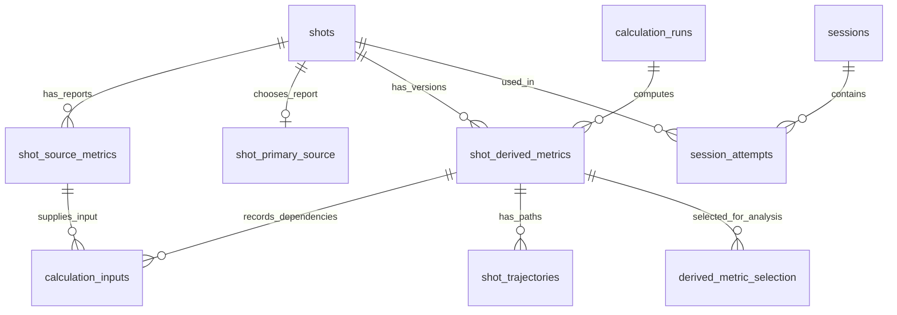

# Readable shot data and versioned calculations

Design proposal — 2026-10-10. No production schema/data migration is implemented by this document.
This updates the earlier preference for long-form metric values as the main analytical interface.
The user now prioritizes named columns and a separate, recalculable derived-metrics table.

## Why change

Read-only inspection of the current schema-v1 database found 1,305 physical shots, 2,429
observations, 32,406 metric-value rows, 47 sessions and 1,089 attempts. Counts are a point-in-time
inventory, not migration acceptance targets. 1,089 shots have multiple observations; these often
include ingestion and practice evidence. No shots currently appear in multiple sessions, but the
schema permits it. A migration cannot assume one observation equals one physical shot.

Today `shots` stores identity/time/source club code. Numbers require joins through `observations`,
`metric_values` and definitions. OpenGolfCoach and putting results are frozen in session/attempt
JSON, rather than a queryable derived-metrics table. Export is readable; direct SQL is harder.

## Recommended layout

| Table | One row represents | Purpose |
| --- | --- | --- |
| `shots` | One physical shot, retaining its existing ID | Identity, time, source-event link, synthetic flag; readable identity/date fields |
| `shot_source_metrics` | One normalized source report/revision about a shot | One nullable numeric column per supported metric; immutable source values |
| `shot_primary_source` | The explicitly chosen source report for a shot | Gives everyday queries one source row without discarding other reports |
| `calculation_runs` | One batch using one model/configuration/output schema | Records methodology, settings, code/package identity, lifecycle and publication status |
| `shot_derived_metrics` | One shot result under that run and input/context revision | Separate named columns for TraceLoft outputs; append new results when methods change |
| `calculation_inputs` | One exact source/result/context dependency of a result | Reproducible lineage, including dependencies on earlier calculations |
| `shot_trajectories` | A flight/roll sample sequence belonging to a derived result | Keeps large paths out of the scalar table |
| `derived_metric_selection` | The selected result for a shot, model family and context | Explicit current analytical version; switching it does not rewrite historical results |

Retain raw events, original imports, source/configuration identities, mappings, sessions/attempts,
inclusion decisions and audits. These are evidence/context, not metrics a person must join for
ordinary analysis. Keep the model families separate: full flight, putting, source comparison and
target/game-context analysis. Aggregates/outlier baselines belong to versioned analysis cohorts,
not to the physical-shot metric row.



All source/derived result sets carry `shot_id` as a foreign key to the existing `shots.id`.
Source rows additionally identify their observation and normalization revision. Derived rows
identify `run_id`, their own stable result ID and an input/context fingerprint. Multiple result
versions for one shot are intentional. Composite foreign keys must prevent selecting a report or
derived result belonging to another shot or model family.

## Source metric columns

Call this **source-reported**, rather than measured. Foresight distinguishes camera-captured
launch conditions from calculated flight results. A Foresight carry value remains source-reported;
a TraceLoft/OpenGolfCoach carry estimate belongs in the derived table. Preserve both.
[Foresight launch and flight definitions](https://help.foresightsports.com/hc/en-us/articles/47144162581523-Ball-Launch-Data-Measurements-Ball-Flight-Results).

The user confirmed **17 labels** (four club and thirteen ball/flight fields). Use all 17; do not
drop a field to force the earlier count of 16. Retain total distance as an eighteenth optional
compatibility column because TraceLoft already captures/uses it. The current ball/flight import uses
14 fields. The normalized Open Connect mapping additionally reserves six club fields, but inspection
found no available club values. Source smash factor is not currently mapped; adding its column
does not establish that it arrives in the packet. GC3 documentation lists the four requested club
metrics; a supported display/export is not proof our input currently supplies them.
[GC3 ball/club list](https://www.foresightsports.com/products/gc3).

Confirmed metric dictionary, using familiar golf units in explicit names. Values remain optional;
the source's units/definitions still need verification for each actual input profile.

| Current field | Proposed column | Notes |
| --- | --- | --- |
| `club_speed` | `club_speed_mph` | Club Head Speed; reserved normalized input, no available readings in inspected data |
| Not mapped yet | `smash_factor` | Source-reported Smash Factor; dimensionless |
| `club_path` | `club_path_deg` | Club Path; reserved normalized input |
| `attack_angle` | `attack_angle_deg` | Angle of Attack; reserved normalized input |
| `carry` | `carry_distance_yd` | Carry Distance; provider flight calculation |
| `ball_speed` | `ball_speed_mph` | Initial speed |
| `total_spin` | `total_spin_rpm` | Preserve provider value |
| `launch_ang` | `launch_angle_deg` | Vertical launch |
| `launch_dir` | `launch_direction_deg` | Target-relative, right positive |
| `spin_axis` | `spin_axis_deg` | Preserve provider sign/frame lineage |
| `back_spin` | `backspin_rpm` | Provider component |
| `side_spin` | `sidespin_rpm` | Provider component/sign lineage |
| `peak_height` | `apex_height_ft` | Explicit feet |
| `descent_ang` | `descent_angle_deg` | Provider landing-angle definition |
| `offline` | `offline_distance_yd` | Endpoint semantics currently unverified; do not silently rename carry-side |
| `curve` | `curve_distance_yd` | Definition/frame retained |
| `hang_time` | `flight_time_s` | Provider flight duration |
| `total` | `total_distance_yd` | Additional optional compatibility field; not in the user's 17-label list |

Store a supplied Smash Factor in the source table. If TraceLoft calculates ball speed / club speed,
store it separately as `calculated_smash_factor` in the derived table, under that methodology's
version. Require compatible speeds and positive club speed; missing/zero/invalid club speed makes
the ratio unavailable. Never fill a missing source smash-factor column with our calculation.

Face angle/dynamic loft/lie must not be presented as GC3 capabilities simply because the generic
protocol accommodates them. Other monitors can use nullable additional columns or an extension
table with typed definitions; core metrics should stay wide and easy to query.

Columns are optional: absence is `NULL`, not zero. Keep source-report ID, source/device/profile,
mapping revision and per-field availability/quality evidence. A companion quality table can distinguish
not supplied, unavailable and invalid without forcing JSON parsing for basic numerical queries.
Preserve raw input separately. Unit normalization is a documented mapping operation, not a new
TraceLoft flight estimate. Existing canonical SI values and original units remain recoverable in
legacy evidence; verify conversion in backfill. Never combine conflicting observations with `MAX`
or choose by incidental row order. Backfill primary-source selection with explicit policy/evidence;
unresolved conflicts remain flagged and unselected.

## Derived columns and recalculation

Initial wide columns should include modeled carry/total, carry-side/total-side, absolute offline,
apex, descent, flight time, landing speed, flight shape and runout. Putting adds estimated stopping
distance and required pace under saved Stimp/model assumptions. Prefix source/model comparison
columns clearly (`carry_model_minus_source_yd`, for example); only compare compatible definitions.
Source total minus source carry and modeled total minus modeled carry are separate calculations,
and neither proves curved rollout path length.

Each result needs:

- Shot ID, stable result ID, run ID and model family.
- Exact selected source-report/normalization revision and dependent-result IDs.
- Model name/version, code hash or release identity, package version and output-schema revision.
- Frozen model parameters and relevant context (environment, Stimp, handedness, club/intent revision,
  targets); canonical input/context hash and computation timestamp.
- Success/unavailable/error status with missing-input reasons. A missing club speed cannot yield a
  measured smash factor; model-inferred delivery remains explicitly estimated.

Use non-null context identity: `shot` for context-free flight, or a stable attempt/context revision
for target-dependent results. One physical shot can serve different targets, Stimp assumptions or
scenarios; `shot_id` alone is not a sufficient unique key for those calculations. SQL uniqueness
must not rely on nullable context fields. For retry safety use a unique computation identity over
shot, model/code/output revision, parameters, context and input revisions; orchestration attempts
are separate from the immutable successful result.

Example: shot S123 retains Foresight carry 151.2 yd. OpenGolfCoach v1 produces 149.8 yd; a revised
calculation produces 152.0 yd. All three remain queryable. Analysts can select either calculation
revision, compare changes and export the methodology used.

Recalculation workflow:

1. Freeze the selected shot/source/context IDs and calculation specification.
2. Calculate into a staging run; record coverage, skipped inputs and failures. Retry idempotently.
3. Review old/new differences and sample counts; a partial/error run cannot silently replace the
   default. An explicit partial publication must identify its scope and unavailable results.
4. Publish the approved result selection atomically. Previously published runs/exports stay readable.
5. Invalidate dependent summaries/detectors by revision, recomputing them under the chosen version.

Exclude/include and club retagging do not edit source measurements. Retagging invalidates only
calculations that actually depend on club/context; exclusions change analytical membership.
Outlier metrics/rates record their eligible cohorts and detector versions. Historical Play positions,
penalties, Mulligans/Misreads and scores remain frozen; new calculations are analytical scenarios,
not retroactive rescoring. A saved outcome pins the result revision it used.

## Everyday SQL and exports

Provide documented wide views: `v_shots_source` (one selected source report per physical shot),
`v_shots_analysis` (selected source and explicitly selected derived family/version), and
`v_session_shots` (one row per attempt with current effective bag/club, intent and scoped exclusion).
The analysis view must specify its model/context policy, not select the latest timestamp across
unrelated families. Expose source fields and derived fields separately, never `COALESCE` an estimate
into a source column. Bag/club labels belong in the readable views even if entities use stable IDs.

Example intended interface after migration:

```sql
SELECT shot_id, occurred_at, bag_name, club_name,
       source_carry_distance_yd, model_carry_distance_yd,
       model_name, model_version, calculation_run_id
FROM v_session_shots
WHERE session_id = :session_id AND analysis_excluded = 0;
```

Physical-shot exports must not multiply rows when several sessions or observations exist.
Offer source-only, selected-source-plus-derived, session-attempt and all-calculation-history CSVs,
with units/version/context fields and missingness dictionaries. This preserves spreadsheet-friendly
columns while retaining competing source values and old models for research.

## Staged migration and acceptance

1. Use the confirmed 17-label dictionary plus optional total distance. Verify actual incoming
   semantics/units, finish source-selection policy/versioned output families and finalize DDL.
2. Take a verified SQLite backup and restore into isolation; inventory IDs, raw bytes, observations,
   duplicates/conflicts, sessions/attempts, tags/exclusions, corrections and frozen game outcomes.
3. Add wide tables and views alongside v1 evidence. Backfill every original observation with its
   own report ID; do not collapse conflicting reports or manufacture missing values. Preserve old
   derived payloads as legacy results with their actual lineage or explicitly incomplete provenance.
   Do not claim a reconstructible run/hash when original inputs or implementation identity are absent.
4. Verify source equality within documented unit-conversion tolerance, availability/zero distinctions,
   foreign keys, duplicate receipts, multiple observations/contexts and existing analytical exports.
5. Switch ingestion, querying, CSV, backup and model writes together under the Python authority.
   Receipt/source/session writes remain atomic; read compatibility is retained during transition.
6. Exercise interrupted/retried recalculation, failed/partial publication, version switching,
   club-dependent invalidation, exclusions, restored backups and frozen round review in isolation.
7. Cut over only after reconciliation. Retain rollback support and legacy evidence; no database wipe
   or dropping old tables is needed to make the new interface readable. Schema-v1 `Store` currently
   rejects newer versions, so rollback means a verified pre-upgrade snapshot plus matching service,
   not opening an upgraded database with the old binary.

The production database, service and existing model outcomes are unchanged by this proposal.
